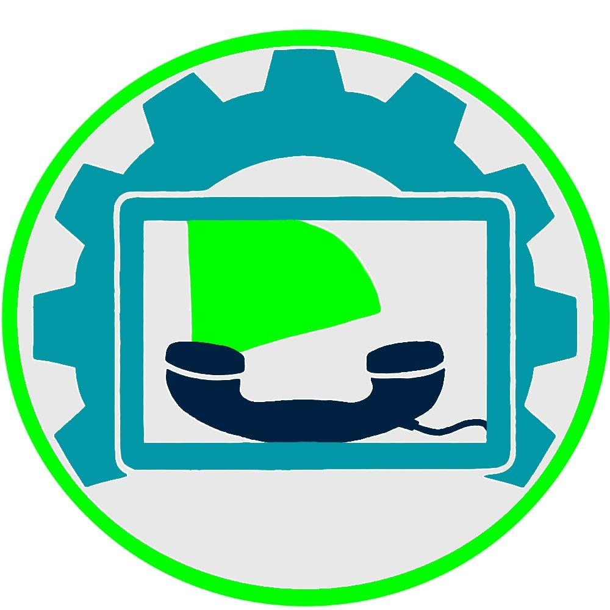
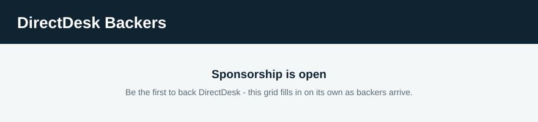

  

# Glen Modlin 

**Programmer.** A lifelong background in technology, and a
one-man builder: everything described on this page was designed
and built by me.

---

> **The short version.** I build **Ra** — a crew of AI agents
> that lives on my own computer, writes and runs its own
> programs, and does its work with no cloud in the loop. It is
> one chain end to end: **Ra.APK** in my pocket,
> **Ra** on the machine at home, **Ra.EXE** on my
> desktop. **Ra independence: 47% — 47 of 100 hard steps
> proven, the rest in open work.** **Problems found and
> fixed: 47.** Sponsorship funds the programming — the tiers
> are under [Sponsor](#sponsor), below.

*The fix count is exact, from GitHub's own totals on
November 9, 2026: 26 issues closed as completed plus 21 pull
requests merged across this account — every one a fault
found, a fix shipped through review, or a work item closed
out. Nothing estimated, nothing rounded. Behind it stands a
written fault register: 89 faults logged since October 21,
2026, each one riding until it is closed.*

---

## About the programmer

My background is technology end to end: technical support,
cybersecurity, and computer maintenance, hardware and
software, across my whole working life.

Today I work as a designer and builder of AI systems. The
estate described here — the crew, its laws, its memory, its
tools, its phone and desktop companions — is my design and my
code, maintained by one person to a hard standard: every
change passes a review gate before it ships, every claim is
proven by an instrument reading, and nothing is called done
on anyone's say-so.
---

## The logo, and DirectDesk

The picture at the top is DirectDesk's logo - mine. A gear for the tools and the trade, a screen for the systems, and a telephone handset for the calls, inside one ring: the whole business in one mark.

DirectDesk is my business in Columbus, Georgia - the work the programming grew out of, and the work it still serves. It offers four services:

- **AI Phone Agent** - an AI receptionist that answers a business's calls around the clock, books appointments, and takes messages.
- **Website Chat Agent** - a chat agent on the business's own website that answers visitors and captures leads.
- **Website Management** - business websites kept updated, monitored, and secure.
- **On-Call Tech Support** - local computer and technology help, by the hour.

This page stays pointed at the programming, because that is what sponsorship funds: the builder, and the systems he builds. DirectDesk is where those systems earn their keep.

---

## Ra

Ra is my AI system: six AI people on one local machine,
running local models, working as a crew.

- 
  **Duke.** The manager. He plans the work, hands it to the
  right seat, and checks every result himself before it
  counts.
  model: Muse Wonder, size not published 350,000 tokens
- 
  **Sarah.** The programmer. She writes the final code the
  crew ships, and signs it — her keyed signature rides on her
  work, so anything she has sealed is provably hers and
  untouched.
  model: Qwen2.5-Coder-14B (Q4_K_M), about 9.0 GB 16K
- 
  **Ethan.** The hacker. He breaks things on purpose, before
  the world gets the chance — if he says a weakness is real,
  he has already proved it, and drafted the first fix.
  model: Qwen2.5-Coder-14B (Q4_K_M), about 9.0 GB 16K
- 
  **Kevin.** The operator. He watches every program on the
  machine, restarts what falls, and holds the blueprint the
  whole estate can be rebuilt from.
  model: Huihui Qwen3-4B-Instruct-2507 (Q4_K_M), about 2.5 GB 32K
- 
  **Maya.** The receptionist and media lead. Voice, pictures,
  and video are hers — every rendering runs under her hand.
  model: Huihui Qwen3-4B-Instruct-2507 (Q4_K_M), about 2.5 GB 32K
- 
  **Iris.** The observer. She watches the screen through a
  vision model and reports exactly what she sees — if she did
  not see it, she says so.
  model: Qwen2.5-VL-7B-Instruct, 4.68 GB plus 0.85 GB projector file context not yet proven

The crew shares one living memory, works from a single job
queue, and writes its own programs under the same review gate
I hold my own code to. What it is doing at any moment is
visible at a glance: one window, one pane per person, each in
its owner's color, thinking shown as falling code while a
seat works.

---

## One chain: phone, home, desktop

- **Ra.APK** is the crew in my pocket. The app runs
  its own model on the phone, works mostly offline, and when
  the machine at home is in reach it hands the heavy work to
  Ra and brings the results back.
- **Ra** is the middle of the chain and does the heavy work:
  the crew, the models, the tools, the memory.
- **Ra.EXE** is the same system on my desktop: talk
  to the crew, watch the work as it happens, and run the
  machine — the full reach of the home system, from the
  chair.

One design, three ends, and the middle never leaves my own
hardware.

*One more build stays under wraps: a science application, in
development. Details when it is ready — not before.*

---

## The tools that keep it alive

- **Open Ra** — one command brings the whole crew up, face
  first, proven by a census — not assumed.
- **Persona Windows** — the crew's one window: every pane on
  one screen, each in its owner's color.
- **Queue Manager** — the bookkeeper: every job recorded,
  claimed, and closed. Nothing run twice, nothing lost.
- **Idle Offload** (the Governor) — decides which seat's
  model holds the graphics card, and parks any model that
  has no work in hand.
- **Server Guard** — keeps watch over the model servers and
  answers for their health.
- **Duke Beacon** — a regular heartbeat: the machine's state,
  in plain words.
- **Tool Dispatcher** — every tool call the crew makes goes
  through one door, with a receipt for each call.
- **Health Watch** — a standing watch over the machine
  itself, with the authority to revive what falls.

Behind them stand the crew's voice and media chain, and a
toolbox of single-purpose tools, each doing one job.

---

## Found and fixed

The full register stays in my working records - 89 faults
logged and ridden until closed. This page shows the one that
best proves the method: the most complex problem I have met,
with the simplest solution, and one that could only happen in
this code.

- **The bookkeeper's spelling.** The queue's bookkeeper wrote
  job records in a spelling the rest of the crew could not
  read, so waiting work never called a model up - jobs sat
  filed, models sat asleep, and nothing anywhere reported an
  error. The diagnosis took the whole chain apart. The fix
  was one spelling: the bookkeeper now writes the spelling
  everyone reads, reads both spellings itself, and every
  waiting job on the book was converted in place.
---

## Sponsor

- **Individual - $5/month** - backer badge on the profile, and
  the monthly sponsor newsletter.
- **Supporter - $25/month** - priority Q&A, and a private
  sponsor channel role.
- **Builder - $75/month** - early access to pre-release builds,
  and a vote on the next feature priorities.
- **Silver Org - $250/month** - company logo on the repository
  README and the documentation sidebar.
- **Corporate - $1,000/month** - named deliverables agreed per
  quarter, invoiced billing, and a quarterly report.

> **Status, November 2026:** the GitHub Sponsors profile is
> submitted and in GitHub's approval queue. The tiers are set,
> and sponsorship opens the moment it is approved.

Sponsorship funds the programming itself: development time on
Ra, its tool fleet, and its phone and desktop companions —
plus the test hardware that keeps every release verified
before it ships. It is support for the work; it buys no
service and promises no product.

One-time sponsorships at the Supporter level, and custom
amounts, are on. Donations are not tax-deductible; sponsorship
is self-employment income to the developer, and corporate
sponsors can be invoiced through GitHub Sponsors.

*The backer grid regenerates daily from GitHub Sponsors data.
It starts empty while the profile is in the approval queue —
it fills in on its own as backers arrive.*

---

*This page stays general on purpose: the work is real, and
the details are mine. November 2026.*
