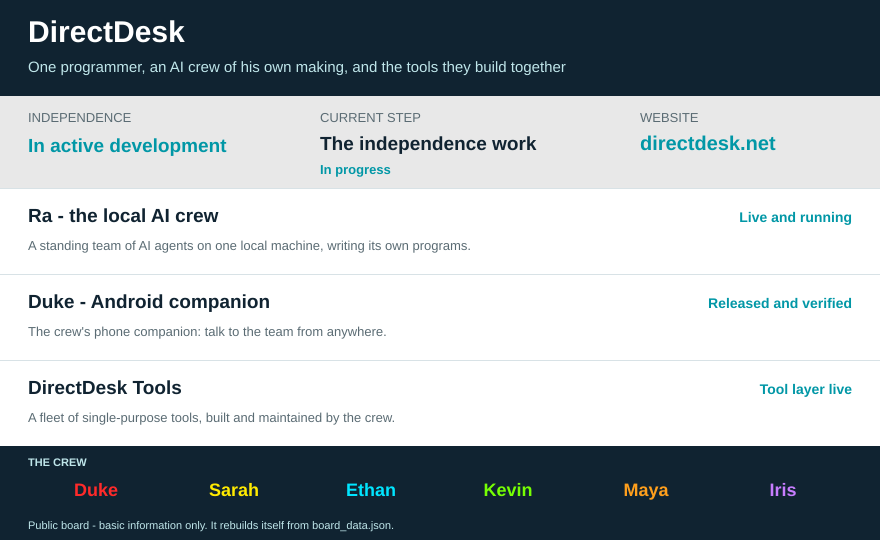

  

# Glen Modlin 

**Programmer.** A lifelong background in technology, and a
one-man builder: everything described on this page was designed
and built by me.

---

> **The short version.** I build **Ra** — a crew of AI agents
> that lives on my own computer, writes and runs its own
> programs, and does its work with no cloud in the loop. It is
> two places: **Ra.APK** on my phone, and **Ra.EXE**
> on my laptop. **Ra independence: 58% — 58 of 100
> hard steps proven, the rest in open work.**
> **Problems found and fixed: 71.** Sponsorship funds the programming — the tiers
> are under [Sponsor](#sponsor), below.
>
> Behind this page stands the whole estate, counted on
> November 10, 2026: **160 repositories — 3 public and 157
> private — and 9,355 saves (commits) across my own 158
> projects.** Every project is listed under
> [The whole estate](#the-whole-estate), below.

*The fix count is exact, from GitHub's own totals on
November 10, 2026: 49 issues closed as completed plus 22 pull
requests merged across this account — every one a fault
found, a fix shipped through review, or a work item closed
out. Nothing estimated, nothing rounded. Behind it stands a
written fault register: 89 faults logged since October 21,
2026, each one riding until it is closed.*

---

## Sponsor

- **Individual - $5/month** - backer badge on the profile, and
  the monthly sponsor newsletter.
- **Supporter - $25/month** - priority Q&A, and a private
  sponsor channel role.
- **Builder - $75/month** - early access to pre-release builds,
  and a vote on the next feature priorities.
- **Silver Org - $250/month** - company logo on the repository
  README and the documentation sidebar.
- **Corporate - $1,000/month** - named deliverables agreed per
  quarter, invoiced billing, and a quarterly report.

> **Status, November 2026:** the GitHub Sponsors profile is
> submitted and in GitHub's approval queue. The tiers are set,
> and sponsorship opens the moment it is approved.

Sponsorship funds the programming itself: development time on
Ra, its tool fleet, and its phone and laptop companions —
plus the test hardware that keeps every release verified
before it ships. It is support for the work; it buys no
service and promises no product.

One-time sponsorships at the Supporter level, and custom
amounts, are on. Donations are not tax-deductible; sponsorship
is self-employment income to the developer, and corporate
sponsors can be invoiced through GitHub Sponsors.

*The backer grid regenerates daily from GitHub Sponsors data.
It starts empty while the profile is in the approval queue —
it fills in on its own as backers arrive.*

---

## About the programmer

My background is technology end to end: technical support,
cybersecurity, and computer maintenance, hardware and
software, across my whole working life.

Today I work as a designer and builder of AI systems. The
estate described here — the crew, its laws, its memory, its
tools, its phone and laptop companions — is my design and my
code, maintained by one person to a hard standard: every
change passes a review gate before it ships, every claim is
proven by an instrument reading, and nothing is called done
on anyone's say-so.
---

## The logo, and DirectDesk

The picture at the top is DirectDesk's logo - mine. A gear for the tools and the trade, a screen for the systems, and a telephone handset for the calls, inside one ring: the whole business in one mark.

DirectDesk is my business in Columbus, Georgia - the work the programming grew out of, and the work it still serves. It offers four services:

- **AI Phone Agent** - an AI receptionist that answers a business's calls around the clock, books appointments, and takes messages.
- **Website Chat Agent** - a chat agent on the business's own website that answers visitors and captures leads.
- **Website Management** - business websites kept updated, monitored, and secure.
- **On-Call Tech Support** - local computer and technology help, by the hour.

This page stays pointed at the programming, because that is what sponsorship funds: the builder, and the systems he builds. DirectDesk is where those systems earn their keep.

---

## Ra

Ra is my AI system: six AI people on one local machine,
running local models, working as a crew.

- 
  **Duke.** The manager. He plans the work, hands it to the
  right seat, and checks every result himself before it
  counts.
  model: Muse Wonder, size not published 350,000 tokens
- 
  **Sarah.** The programmer. She writes the final code the
  crew ships, and signs it — her keyed signature rides on her
  work, so anything she has sealed is provably hers and
  untouched.
  model: Qwen2.5-Coder-14B (Q4_K_M), about 9.0 GB 16K
- 
  **Ethan.** The hacker. He breaks things on purpose, before
  the world gets the chance — if he says a weakness is real,
  he has already proved it, and drafted the first fix.
  model: Qwen2.5-Coder-14B (Q4_K_M), about 9.0 GB 16K
- 
  **Kevin.** The operator. He watches every program on the
  machine, restarts what falls, and holds the blueprint the
  whole estate can be rebuilt from.
  model: Huihui Qwen3-4B-Instruct-2507 (Q4_K_M), about 2.5 GB 32K
- 
  **Maya.** The receptionist and media lead. Voice, pictures,
  and video are hers — every rendering runs under her hand.
  model: Huihui Qwen3-4B-Instruct-2507 (Q4_K_M), about 2.5 GB 32K
- 
  **Iris.** The observer. She watches the screen through a
  vision model and reports exactly what she sees — if she did
  not see it, she says so.
  model: Qwen2.5-VL-7B-Instruct, 4.68 GB plus 0.85 GB projector file context not yet proven

The crew shares one living memory, works from a single job
queue, and writes its own programs under the same review gate
I hold my own code to. What it is doing at any moment is
visible at a glance: one window, one pane per person, each in
its owner's color, thinking shown as falling code while a
seat works.

---

## One chain: phone and laptop

- **Ra.APK** is the crew in my pocket. The app runs
  its own model on the phone, works mostly offline, and when
  my laptop is in reach it hands the heavy work to Ra.EXE
  and brings the results back.
- **Ra.EXE** is Ra on my laptop: the crew, the models,
  the tools, the memory — the heavy work happens there. I
  talk to the crew, watch the work as it happens, and run
  the machine from the same window.

One system, two places, and neither end ever leaves my own
hardware.

*One more build stays under wraps: a science application, in
development. Details when it is ready — not before.*

---

## The whole estate

Everything I have built, counted from GitHub's own records
on November 10, 2026 — the private projects included,
because the work is the boast, public or not:

- 
  **160 repositories** — 3 public, 157 private.
- 
  **9,355 saves** — commits across my own 158 projects.
- 
  **49 issues closed**, and
  
  **22 pull requests merged** — the found-and-fixed record.
- **150 issues stand open** in active work.
- Counted together with the two public forks below, the
  account holds 21,973 commits; the forks carry their
  upstream projects' histories, so my own number is the
  9,355 above.

Every project, one line each — what it is, and what it does:

### Ra system

- **Ra** — Ra - the laptop and phone applications: Ra.EXE for Windows on the laptop, and Ra.APK for Android on the phone. · Private · 4,958 saves
- **AI_WorkSpace** — AI_WorkSpace: the offline management system for My PC - Drive Listener, voice player, model fetcher, wrappers, BAT chain. · Private · 155 saves
- **Open_Ra** — The one launcher that brings the whole Ra system up on the laptop. · Private · 49 saves
- **Persona_Windows** — The crew's windows: one window per persona, tiled in the two-column grid, each showing its persona's live feed under the matrix rain - symbols and capitals, bold and… · Private · 43 saves
- **Queue_Manager** — The bookkeeper of the Ra work queue. · Private · 39 saves
- **Duke_Beacon** — A small resident that makes the laptop's state visible without the postbox, the listener, or the queue. · Private · 26 saves
- **Kevin_Live_Work** — Kevin Live Work is Kevin the Operator's live work engine in Ra, My standing agent system: it censuses the estate, restarts stopped residents and watchers by name, and… · Private · 23 saves
- **Drive_Listener** — The program that carries out commands on the laptop. · Private · 22 saves
- **Contract_Build_Pipeline** — Consolidated home created 2026-11-09 in the GitHub cleanup the builder ordered. · Private · 20 saves
- **Duke_Postbox_Poller** — the laptop's half of the postbox - the small two-way channel between the laptop and the outside. · Private · 18 saves
- **Server_Guard** — Server Guard Version 2 - never-blocking model server guard: health + graphics-card residency + real generation probe. · Private · 17 saves
- **Close_Ra** — Shuts the whole Ra system down in one click, in an order that sticks: watchers and revivers first so nothing restarts mid-close, then the queue, the windows, the seat… · Private · 15 saves
- **Matrix_Rain** — The falling matrix rain the persona windows wear. · Private · 14 saves
- **Trash_Eraser** — A small tool for clearing out trash files for good. · Private · 13 saves
- **Network_Watch** — Watches the laptop's network in stages - the router, internet anchors, and name resolution - and reports when the network is truly down. · Private · 12 saves
- **PC_Operator** — PC Operator Version 1 - Sarah's priority command operator for the laptop (priority queue, preemption, sentinels, WHY records). · Private · 10 saves
- **Standing_Loop_Watch** — The watcher that keeps the Order Intake program alive, so orders from the builder are never missed. · Private · 10 saves
- **Sweep_Caller** — Sweep Caller runs the standing start-what's-missing sweep once a minute. · Private · 9 saves
- **Tool_Dispatcher** — Ra's single doorway for seat tools. · Private · 9 saves
- **Command_Server** — the laptop's protected command door. · Private · 8 saves
- **Crew_Program_Author** — The crew's program-writing pipeline: an order for a new program runs through the crew - Duke breaks it into steps, Ethan drafts the code, Sarah writes the final code… · Private · 8 saves
- **Drive_Stall_Watchdog** — Drive Stall Watchdog watches the Google Drive sync leg on the PC and, when a stall appears that the first responder cannot clear, runs the recovery, records the… · Private · 8 saves
- **Idle_Offload** — Idle Offload keeps watch over the crew's local AI model servers and unloads any model that has sat idle past its limit, freeing graphics memory and system memory for… · Private · 8 saves
- **Iris_Image_Inspect** — How Iris, the crew's Observer, looks at a finished picture. · Private · 8 saves
- **Powershell_Gate** — PowerShell Gate is the one shared door every program on the PC uses to start PowerShell: one start at a time, starts spaced at least ten seconds apart machine-wide,… · Private · 8 saves
- **Crew_Personas** — Holds the persona files of the Ra crew - the standing instructions each seat loads before it works. · Private · 7 saves
- **Duke_Postbox** — The Google Apps Script postbox Duke, the laptop, and Wolf speak through - store-and-forward mailboxes and the tunnel beacon. · Private · 7 saves
- **Puppy_100_Proofs** — End-to-end proof drivers for the laptop independence list: questions, image orders, and world questions proven through the crew's own window. · Private · 7 saves
- **Sweep** — Sweep checks the standing list of programs that should be running on the PC and starts any that are missing, so a program that stopped quietly is running again within… · Private · 7 saves
- **Tool_Registry** — The tool registry for Ra, My standing agent system: the one list every tool call is checked against - each tool's name, the program that runs it, its owner, its… · Private · 7 saves
- **Boot_Singleton** — The singleness gate every Ra resident starts through: a claim of process number plus creation time, so a boot can never raise two of anything. · Private · 6 saves
- **Health_Watch** — Kevin the Operator's resident health monitor. · Private · 6 saves
- **Queue_Guardian** — A small resident that lives outside the queue and keeps exactly two programs alive - the Queue Bridge Keeper and the Queue Manager - across logouts, logins, and… · Private · 6 saves
- **Findings_Queue_Keeper** — Findings Queue Keeper Version 1 - one store for every estate finding: sweep, fingerprint, gate, lessons ledger. · Private · 5 saves
- **Order_Seat_Server** — Order Seat Server stands up one crew seat's model server (llama-server) on the computer: clears the seat's port, starts the server windowless with its output in the… · Private · 5 saves
- **Outside_Helper** — The Outside Helper: the black-box recorder and the guardian service that watch Ra from outside it, plus the one canonical copy of the shared cure text the seven… · Private · 5 saves
- **Sarah_Seal** — Sarah's keyed signature system for crew-written programs. · Private · 5 saves
- **Screen_Watch** — The estate's screen watcher. · Private · 5 saves
- **Degenerate_Output_Guard** — Stops model output that degenerates into repetition loops - the failure that once flooded the persona windows with the same words hundreds of times. · Private · 4 saves
- **Move_Synced_Programs_To_Pc_Home** — Two-stage mover that moves the seven programs the laptop 100 item 80 census caught running from the synced programs home into the PC-only programs home, with checksum… · Private · 4 saves
- **Board_Keeper** — Board Keeper Version 1: the one owner of the Progress Board's state file; reads dropped event files, keeps the stages, the feed, and the headline sentences true. · Private · 3 saves
- **Crew_Chain_Keeper** — Keeps the crew conversation moving without idle gaps. · Private · 3 saves
- **Crew_Conversation** — The crew conversation itself: the seats take their turns through a shared feed, and every message crosses a quality gate before it lands - looping or malformed text… · Private · 3 saves
- **Crew_Job_Wrapper** — The envelope that carries a crew job through the queue. · Private · 3 saves
- **Crew_Pixel_Tracker** — Turns the estate's finished work into a growing picture. · Private · 3 saves
- **Crew_Pixel_Viewer** — Crew Pixel Viewer Version 2: a small standalone window that shows the Crew Pixel Picture as the crew paints it, sized from the picture file's own dimensions. · Private · 3 saves
- **Crew_Seat_Call** — The small caller every Ra program uses to talk to one crew seat's local model. · Private · 3 saves
- **Drive_Stall_Recovery** — The recovery procedure for a stalled Google Drive sync, as a program. · Private · 3 saves
- **Duke_Voice_TTS** — Duke's voice as a program. · Private · 3 saves
- **Duplicate_Watch** — Duplicate Watch keeps a census of the helper programs running on the PC and reports any that are running more than once. · Private · 3 saves
- **Estate_Housekeeper** — One double-click run, made while the estate is fully stopped. · Private · 3 saves
- **Estate_Organizer** — Inventories the whole computer and tidies the programs folder. · Private · 3 saves
- **Integrity_Watch_V1** — Integrity Watch Version 1 - continuous SHA-256 self-audit program for an artificial intelligence's own estate. · Private · 3 saves
- **Kevin_Panel_Feed** — Kevin Panel Feed Version 3: fills Kevin's pane in the Persona Windows face with plain factual lines assembled from the estate's own instrument readings, plus a… · Private · 3 saves
- **Local_Duke_Window** — My typing window to the local Duke seat. · Private · 3 saves
- **Loop_Walls** — The two walls every crew message crosses. · Private · 3 saves
- **Order_Seat_Forward** — Order Seat Forward Version 1: starts one seat's Seat Forwarder and proves the whole partner path to the seat's model with a real proof request, recorded in a receipt. · Private · 3 saves
- **Persona_Window** — One window for one persona. · Private · 3 saves
- **Postbox_Freight_Send** — Sends one file from the laptop through the Apps Script mailbox as base64 freight: a manifest message (name, byte count, hash, chunk count) followed by numbered chunk… · Private · 3 saves
- **Postbox_Mailbox_Repair** — The repair tool for a jammed postbox. · Private · 3 saves
- **Queue_Bridge_Keeper** — The ferry between the synced queue inbox and the Queue Manager's own home on the laptop. · Private · 3 saves
- **Queue_File_Job** — The small tool that files a job into the Ra queue. · Private · 3 saves
- **Ra_Self_Check** — Ra's standing self-check. · Private · 3 saves
- **Resource_Watchdog** — Resource Watchdog Version 1: the watcher of the watcher; checks the Resource Manager's heartbeat and restarts the Resource Manager, with a written claim receipt, when… · Private · 3 saves
- **Seat_Forwarder** — Gives a second seat its own address onto a shared model server. · Private · 3 saves
- **Start_Estate** — The estate's starter: one double-click runs the Estate Starter program, which brings the whole team up on the PC. · Private · 3 saves
- **Stop_Estate** — Stops the whole estate and holds it down. · Private · 3 saves
- **Tunnel_Guardian** — The resident guardian of the laptop's three communication legs - the postbox poller, the Drive listener, and the tunnel. · Private · 3 saves
- **Tunnel_Verdict_Beacon** — The verdict mathematics of the tunnel estate. · Private · 3 saves
- **Watchdog_Supervisor** — The supervisor over the Drive Stall Watchdog - no guard sleeps unwatched. · Private · 3 saves
- **Watch_Engine** — Watches the work engine for real progress. · Private · 3 saves
- **Autostart_Reproof** — Instrument that proves Ra returned by login autostart after a real reboot (the laptop 100 item 19). · Private · 1 save
- **Face_Stand_Check** — Watcher that proves the Beacon reads FACE 1 OF 1 across a full day of status files (the laptop 100 item 26). · Private · 1 save
- **Seat_Terminal_Proof** — Watcher that proves a seat server starts on demand with no server terminal window (the laptop 100 item 25). · Private · 1 save

### Memory

- **DirectDesk_Offline_Memory** — My crew's one living memory: a single private store every seat reads and writes. · Private · 43 saves
- **Persona_Memory** — Persona Memory Version 1 - per-persona memory stores for Duke, Ethan, Maya and Sarah (SQLite FTS5 + sqlite-vec, mem0 write gate). · Private · 17 saves
- **Memory_Compiler** — A tool that packs everything the AI helpers know into tidy bundles they can read and learn from. · Private · 14 saves
- **Fetch_Knowledge** — The crew's internet reading tool. · Private · 6 saves
- **Memory_Compiler_V1** — Compiles the estate's memory files into usable packs. · Private · 2 saves
- **Memory_Compiler_V2** — Version 2 of the Memory Compiler. · Private · 2 saves

### DirectDesk business

- **DirectDesk_Tools** — The toolbox behind DirectDesk — My phone-answering business — plus a large ready-made tool collection it was built from. · Private · 2,476 saves
- **d9rectdesk** — This public profile page, its self-updating board, and its sponsor setup. · Public · 77 saves
- **Webchat_V2** — Webchat V2: website-effects styling, resizable chat panel, Enter sends / Shift+Enter newline (V1 frozen). · Private · 45 saves
- **directdesk-voice** — DirectDesk Voice Assistant — Nano-powered default assistant for Android (personal use). · Private · 32 saves
- **Webchat_V3** — Webchat V3: clean-start fork of frozen V2 - spell-suggest , quiet console, full prompt cap fix, site-CSS alignment + BubbleWobble. · Private · 29 saves
- **DirectDesk_Webchat_Agent** — DirectDesk Webchat Agent — an embeddable website chat that runs a small Gemma model in the visitor's browser and answers from a SQLite database of DirectDesk facts. · Private · 28 saves
- **Webchat** — DirectDesk standalone website chat bubble - its own exe, local model, facts-file trained, visitor-walled. · Private · 23 saves
- **directdesk-spec** — All specifications — the main app spec, the webchat spec, the feature list, research, and templates. · Private · 13 saves
- **.github** — Account-level setup for this profile: the sponsor button and profile configuration. · Private · 7 saves
- **directdesk-toolbox-core** — The offline agent core — plain-language request in, correct tool selected and run, result out. · Private · 7 saves
- **directdesk-tool-arg-validator** — Validate and coerce kwargs against a tool manifest schema. · Private · 6 saves
- **directdesk-tool-cycle-finder** — DFS cycle detection on an adjacency dict — zero dependencies. · Private · 6 saves
- **directdesk-tool-json-extractor** — Extract a JSON object from messy LLM output. · Private · 6 saves
- **Maya_Media_Render** — The picture-making program under Maya, who owns all media. · Private · 6 saves
- **Solomon_Order_Intake** — Lets the builder give orders to the crew in his own words. · Private · 6 saves
- **Maya_Silence** — Maya's standing reports on what the crew is doing. · Private · 3 saves
- **directdesk-suspended-work** — Suspended DirectDesk Tools work — backup of in-flight tasks with resume instructions. · Private · 2 saves

### Tools and utilities

- **Sudo_V1** — Sudo Service Version 1 - Sarah-gated admin escalation for the operating set. · Private · 28 saves
- **Web_Chat** — A chat window for a website. · Private · 16 saves
- **Model_Workshop** — The workshop for AI model files — where models are checked, prepared, and kept in order. · Private · 14 saves
- **Achievements_Log** — The estate's honours list: the running log of instrument-proven achievements. · Private · 13 saves
- **Desktop_Pet** — A small pet that lives on the computer screen and keeps company while I work. · Private · 8 saves
- **GitHub_Sync** — Consolidated home created 2026-11-09 in the GitHub cleanup the builder ordered. · Private · 8 saves
- **Killswitch** — The estate Killswitch Version 1 - one action closes all AI background activity in order. · Private · 8 saves
- **Toolbox** — My box of small tools — each one does a single job. · Private · 8 saves
- **Control_Terminal** — Control Terminal (Local Duke Window) - My input terminal: Killswitch panel, Clean Slate, Start, commander dialogue, fast lane. · Private · 7 saves
- **Video_Gen** — The estate's video maker. · Private · 7 saves
- **Voice_Player** — The laptop's single voice queue: everything spoken on My PC goes through it in arrival order, nothing talking over anything. · Private · 7 saves
- **Payload_Builder** — Payload Builder Version 1 - the only sanctioned command assembler for the Drive loop, with result checking. · Private · 6 saves
- **Start_Whats_Missing** — The sweep that keeps the estate complete. · Private · 6 saves
- **Sync_Scheduler** — Sync Scheduler Version 1 - staged local mover flushing the Drive loop lanes every 5 seconds, commands first. · Private · 6 saves
- **System_Logger_V1** — System Logger Version 1 - frozen installed build (estate tool). · Private · 6 saves
- **Text_Layer** — Puts true words and numbers onto pictures. · Private · 6 saves
- **Worker_Ladder** — A test rig that answers one question: how many small models can work at once? It runs pairs of model servers side by side through simultaneous generation, load/unload… · Private · 6 saves
- **Offline_Patch_Kit_V1** — Offline Patch Kit Version 1 - review gate and turn machinery for the local crew. · Private · 5 saves
- **Source_Auditor** — Consolidated home created 2026-11-09 in the GitHub cleanup the builder ordered. · Private · 5 saves
- **System_Logger_V2** — System Logger Version 2 - full diagnostics + brains feed (estate tool). · Private · 5 saves
- **Window_Keeper** — Keeps the estate's relaunch windows alive: the keeper censuses the five windows every 30 seconds and revives any that died on their own. · Private · 5 saves
- **Conversation_Organizer** — Runs the crew's conversation cycles. · Private · 4 saves
- **Pc_Home_Compare** — Program that proves every live program runs from the PC-only programs home by comparing the two program lists and censusing live processes (the laptop 100 item 80). · Private · 4 saves
- **Self_Correct** — A checker that reads code, finds mistakes, and suggests fixes — it never changes anything on its own. · Private · 4 saves
- **Skeletons** — The starting frames: one good example of every kind of file, so new programs begin from something that already works. · Private · 4 saves
- **Solution_Scan** — Scans open-source project code for working solutions to the estate's standing problems and digests where each mechanism lives. · Private · 4 saves
- **Web_Pet** — The website chat with the animated pet built in — the pet dances and reacts while visitors chat. · Private · 4 saves
- **Conversation_Stitcher** — Turns the crew's stitched conversation into sound. · Private · 3 saves
- **Count_Files** — Count Files is a small utility that counts the files in a folder and reports the total. · Private · 3 saves
- **Feed_Post** — Posts one line into the crew conversation feed. · Private · 3 saves
- **Fetch_Model** — Gets a model file from Hugging Face into its proper home on My PC. · Private · 3 saves
- **File_Manager** — Carries out file-management jobs on the PC. · Private · 3 saves
- **Fix_Runtime** — Repairs the runtime layer of the estate's case-flip corruption: letter-case flips in the names after a dot (like os.envIron for os.environ) that compile cleanly and… · Private · 3 saves
- **Fix_Syntax** — Repairs single-letter case flips in the estate's Python files - flipped keywords, builtin names, and escape letters inside strings - then compile-checks every file… · Private · 3 saves
- **Kokoro_Render** — Renders one text file to one spoken audio file with the Kokoro-82M text-to-speech model. · Private · 3 saves
- **Model_Call** — Runs one question against one model and prints the answer with its receipt. · Private · 3 saves
- **Model_Park** — Frees the graphics card on demand. · Private · 3 saves
- **Move_All_Models** — The model consolidation run: it moves every AI model into one single home folder, renames that folder under the naming law, and sweeps every reference to the old… · Private · 3 saves
- **Order_Image_Gen** — The intake's image-order runner. · Private · 3 saves
- **Qrcodegen** — A QR code generator library in Python (the Nayuki library) carried for the estate's programs, so anything that needs a QR code can make one locally. · Private · 3 saves
- **Resource_Manager** — The standing resource manager for the whole device, built after a freeze locked the machine. · Private · 3 saves
- **System_Logger** — The system logger for the laptop. · Private · 3 saves
- **Tool_Forge** — Tool Forge is the crew's tool builder. · Private · 3 saves
- **Web_Fetch** — The crew's internet research tool. · Private · 3 saves
- **Web_Search** — Gives the local models a way to search the web. · Private · 3 saves
- **Wedge_Cut** — Cuts one wedged Drive Listener command loose without touching any resident. · Private · 3 saves
- **Black_Box_Recorder** — the laptop's flight recorder: a five-second snapshot of every program, the graphics card, power, sessions, and Windows errors into a local ring file, with the minutes… · Private · 2 saves
- **Self_Correct_V1** — A fast offline self-audit engine an AI runs against work it is about to call done. · Private · 2 saves

### Other builds

- **Antigravity_Copilot** — My offline copilot: an AI helper whose memory is plain files, so any AI model can pick up where the last one left off. · Private · 216 saves
- **Antigravity_Copilot_CMD** — Antigravity Copilot - command-line single-agent AI. · Private · 137 saves
- **Si_Scientist** — A standalone Android science application. What it studies stays under wraps until it is ready. · Private · 59 saves
- **Complex_Agent** — A team of AI helpers in one program — several bots work together on what you ask, on My own computer. · Private · 30 saves
- **Simple_Bot_V3** — Simple_Bot V3: a crew of bots - one controller/front bot pending input, tasked worker bots in their own processes, mirror council, bot-to-bot messages, shared data work. · Private · 27 saves
- **Simple_Bot** — A single offline chatbot that runs on My computer and answers from its own knowledge files — no internet needed. · Private · 21 saves
- **Simple_Bot_V2** — Simple_Bot V2: first ran on the owner's PC + logging-law heartbeat + honest model step + quiet console. · Private · 18 saves
- **Antigravity_Copilot_GUI** — A code editor with an offline AI copilot inside it. · Private · 11 saves
- **Antigravity_Copilot_GUI_V3** — Version 3 of the Antigravity Copilot editor: an offline AI copilot inside a code editor. · Private · 11 saves
- **Complex_Agent_Slim** — A slimmed-down build of the bot — the same idea in a lighter package. · Private · 6 saves
- **Antigravity_Copilot_GUI_V4** — Version 4 of the Antigravity Copilot editor: an offline AI copilot inside a code editor. · Private · 2 saves
- **Complex_Agent_V14** — A crew of AI models that run locally on your own computer, working in two windows: a chat window where you talk to Duke, who directs the work, and a second window… · Private · 2 saves
- **Complex_Agent_V15** — Version 15 of the local multi-model crew: a chat window where you talk to Duke, who directs the work, and a second window scrolling the crew's activity. · Private · 2 saves

### Public forks

- **llama.cpp** — Public fork of the open-source C/C++ engine that runs large language models. It carries its full upstream history; my own changes ride upstream as pull requests. · Public · 12,268 saves
- **matrix** — Public fork of the web-based green code rain. Home of my pulse variant: many drops, flashing white heads, and one bright band sweeping down. · Public · 350 saves

---

## The tools that keep it alive

- **Open Ra** — one command brings the whole crew up, face
  first, proven by a census — not assumed.
- **Persona Windows** — the crew's one window: every pane on
  one screen, each in its owner's color.
- **Queue Manager** — the bookkeeper: every job recorded,
  claimed, and closed. Nothing run twice, nothing lost.
- **Idle Offload** (the Governor) — decides which seat's
  model holds the graphics card, and parks any model that
  has no work in hand.
- **Server Guard** — keeps watch over the model servers and
  answers for their health.
- **Duke Beacon** — a regular heartbeat: the machine's state,
  in plain words.
- **Tool Dispatcher** — every tool call the crew makes goes
  through one door, with a receipt for each call.
- **Health Watch** — a standing watch over the machine
  itself, with the authority to revive what falls.

Behind them stand the crew's voice and media chain, and a
toolbox of single-purpose tools, each doing one job.

---

## Request a feature

Have an idea for something new? Open the feature request form and say it in your own words: what you would like, and what it would help with. Every request goes on the list and gets read.

[Request a feature](https://github.com/d9rectdesk/d9rectdesk/issues/new/choose)

---

---

*This page stays general on purpose: the work is real, and
the details are mine. November 2026.*
